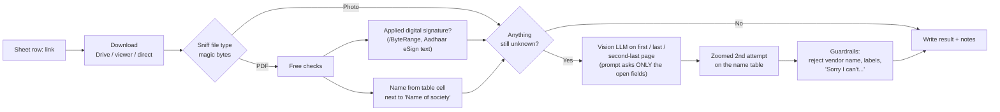

# Agreement Audit with LLM Vision

**An LLM-powered audit system that reads scanned customer agreements and checks them for a missing customer name, a missing stamp or a missing signature, replacing a slow manual review.**

Built and run in production during my role as an Operations Analyst, where it checks **~400 customer agreements a month**. The tool reads each agreement from a Google Sheet and writes the results back to the same sheet.

  

---

## The problem

Every signed agreement had to be checked by a person before the sale could be counted:

| Check | What goes wrong in real uploads |
|---|---|
| **Customer (society) name** | Blank templates, the vendor's own name copied in, handwriting, the wrong name |
| **Stamp / seal** | Missing rubber stamp, or the stamp is on a page nobody looked at |
| **Signature** | Unsigned copies; handwriting that only fills in form fields being mistaken for a signature |

The documents are messy. They include typed PDFs, phone photos (WhatsApp images, rotated), multi-page scans, Aadhaar e-signed PDFs, Google Drive links and links wrapped in Google's document viewer. A human reviewer had to open every file one by one.

## The approach: cheap checks first, AI only for what's left

Calling a 90B vision model on every page is slow (about a minute per document) and rate-limited on the free tier. So the pipeline answers everything it can **for free** first, and sends the model **only the questions that are still open**:



In the production runs this meant a cleanly typed, e-signed PDF was resolved in **a few seconds**, while hard scans that needed the vision model took **about a minute**.

## Product decisions I made (and why)

- **"Review" instead of a guessed "No".** If the model doesn't answer a field, the tool marks it `Review` for a human rather than reporting "not signed". A false "No" would block a valid sale.
- **Every answer explains itself.** A Notes column records *how* each value was found (`Name: table | Digital: Aadhaar eSign | stamp p3/3`), so reviewers can trust the output and spot-check it.
- **Look where signatures actually are.** Signatures and stamps usually sit on the last pages, so the model sees the first page (for the name table) plus the last and second-last pages, not every page.
- **Guardrails on LLM output.** A name is only accepted if it isn't the vendor's own name, a form label, a person's name or a model apology. Replies are parsed even when the model wraps the JSON in markdown or breaks the format.
- **File-name hint for handwriting.** The uploaded file name (e.g. `Green Meadows B wing -1--<uuid>.pdf`) is cleaned into a hint that helps the model read handwritten names. It's used as a last-resort answer only when the name box isn't empty.
- **Built for unreliable APIs.** A global rate limiter shared by all worker threads, exponential backoff with jitter, a fallback to a smaller model (Llama 3.2 11B) on the last try, a same-run retry for timeouts, and a **resumable** run: finished rows are skipped and failed rows are retried up to 3 times.

## Prompt design

Prompts are assembled per document. If the name was already found in the PDF's table, the model is never asked for it. See [`docs/prompt_design.md`](docs/prompt_design.md) and a full example in [`docs/example_prompt.txt`](docs/example_prompt.txt).

## Project structure

```
src/agreement_audit/
  pipeline.py       # audits ONE document: free checks -> vision -> guarded answers
  prompts.py        # dynamic prompt builder (asks only for missing fields)
  vision.py         # image prep, rate-limited client with retries + fallback model, robust JSON parsing
  society_name.py   # table / text extraction, name guardrails, file-name hint
  signatures.py     # deterministic digital-signature detection
  download.py       # Drive / viewer / direct links, file-type sniffing
  batch.py          # parallel runner with progress, error capture and retry
  sheets.py         # Google Sheets runner (production mode, resumable)
  cli.py            # local-folder runner -> CSV report
notebooks/agreement_audit_colab.ipynb   # how it was run day to day
samples/            # fictional sample agreements + example report
tests/              # 19 offline tests (vision model mocked)
```

## Run it

```bash
pip install -r requirements.txt
cp .env.example .env          # add your NVIDIA key (free at build.nvidia.com)

# Offline demo on the fictional samples - no API key needed
cd src && python -m agreement_audit.cli ../samples --no-vision --out ../samples/example_report.csv

# Full run with the vision model
export NVIDIA_API_KEY=nvapi-...
python -m agreement_audit.cli ../samples --out report.csv

# Tests
cd .. && pytest -q
```

**Google Sheets mode:** open [`notebooks/agreement_audit_colab.ipynb`](notebooks/agreement_audit_colab.ipynb) in Colab, store the key in Colab *Secrets* and point it at your sheet.

Example output ([`samples/example_report.csv`](samples/example_report.csv), free checks only):

| File | Society Name | Stamped | Signed | Notes |
|---|---|---|---|---|
| Green Meadows B wing ….pdf | Green Meadows CHSL | Yes | Yes | Digital: Aadhaar eSign text \| Name: table |
| Lakeview Apartments.pdf | Lakeview Apartment Owners Association | Review | Review | Name: table *(stamp/sign go to the vision model)* |
| blank_template.pdf | Not listed | Review | Review | Name box empty (table) |

## What I'd build next

- A small labelled evaluation set to track the accuracy of each field across prompt and model changes
- Confidence scores, so only low-confidence rows go to human review
- Detecting the stamp's position with a lightweight object detector before calling the large model, to cut cost further
- A WhatsApp or Slack alert to the sales owner when their agreement fails a check

---

*All sample documents and names in this repository are fictional. No customer data is included.*
